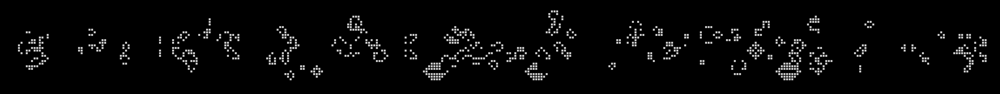

+++
date = '2026-10-10'
draft = false
title = 'Game of Life Rewind'
description = 'A FortID CTF writeup: rewinding a Conway Game of Life board by rendering, simulating and beam-searching the flag forward.'
tags = ['Misc', 'Reversing', 'CTF', 'FortID']
+++

**FortID CTF · Misc / Reversing**

`Game of Life` · `Font rasterisation` · `FFT cross-correlation` · `Beam search`

---

**Flag:** `FortID{R3al_L1f3_H45_N0_R3w1nd_Bu7t0n}`

## The challenge

> I found this neat drawing program online and wrote the flag using one of my favorite fonts. I pressed the play button, and before I could react, the flag transformed itself into these weird shapes. Why is there no rewind button!?
>
> Note: The flag was rendered from one of the DejaVu 2.37 TTF files at an integer pixel size. Every rasterized pixel with an intensity of at least 50% became a live cell.

You get one file, `screenshot.png`: white squares on black, a Conway's Game of Life board some unknown number of generations after someone drew the flag on it.



## Why you can't rewind

Life has no inverse. Many boards evolve into the same board, and some boards (Gardens of Eden) have no predecessor at all. A generic SAT-based reverser would need to undo many generations of a 382-cell-wide board and would drown in valid but wrong predecessors.

The note gives you a way around that. You know exactly how the starting board was made: a DejaVu font, an integer size, and a 50% threshold. So you can run the clock forward instead. Guess the text, render it, simulate, and compare with the screenshot. A correct guess matches every cell.

## Step 1: Read the grid

Each cell is a 6×6 px square on an 8 px pitch. Sample the centre of each cell:

```python
a = np.array(Image.open('screenshot.png').convert('L')) > 128
ys, xs = np.nonzero(a)
T = a[ys.min() % 8 + 3::8, xs.min() % 8 + 3::8]   # 36 x 382, 909 live cells
```

## Step 2: Find the font, size and generation count

Assume the flag starts with the event's prefix, `FortID{`. For every DejaVu 2.37 TTF (22 files) and every size from 8 to 40 px:

1. Render `FortID{` with Pillow (FreeType) and keep pixels with intensity ≥ 128.
2. Evolve it from 0 to 60 generations.
3. Each generation, crop the columns the next character can't have touched yet (more on that below) and slide that crop over the screenshot. FFT cross-correlation computes the mismatch count at every offset in one pass.

Small fragments such as blinkers match by chance, so drop anything with fewer than 25 live cells. One result stands alone:

| font | size | generations | live cells | mismatches |
|---|---|---|---|---|
| DejaVuSansMono-Bold | 16 px | 18 | 87 | **0** |

The runner-up had half its cells wrong. The match also confirms the prefix and pins the canvas-to-grid offset.

Get the fonts from the official release, since the version matters for rasterisation:

```
https://github.com/dejavu-fonts/dejavu-fonts/releases/download/version_2_37/dejavu-fonts-ttf-2.37.tar.bz2
```

## Step 3: Recover the rest

Sans Mono gives every glyph the same advance (about 9.6 px at 16 px), so you know where character *k* sits before you know what it is.

### The light cone problem

A change in Life spreads at most one cell per generation. After 18 generations, character *k* can affect cells up to 18 columns to its left. In theory, then, the columns that depend only on known characters end 18 columns before the next unknown glyph.

My first attempt scored one character at a time against that safe region, and every candidate tied. Changes rarely travel at full speed, so the safe region almost never sees the new character. When I widened the window, greedy picks went wrong after `R3`, because the wider window also catches noise from characters further right.

I measured the real spread by evolving random strings that differ only in their last character. Changes reached 16.7 columns back. That's close to two characters, so each character has to be judged together with its neighbours.

### Beam search with an exact filter

For each step, extend every string in the beam by each character in `[A-Za-z0-9_{}!?-]`, then score each candidate on two regions:

- **Exact region** `[x(k) − 19, x(k+1) − 19)`: no later character can reach these columns. The true string has 0 mismatches here, so throw out any candidate with even one.
- **Soft region** `[x(k+1) − 19, x(k+1) − 4)`: future characters can still reach these columns, but they usually don't. Use the mismatch count here only to rank survivors. Keep the best 400.

Two tricks keep it fast. Simulate a narrow window around the region you're scoring (the window's edges sit more than 18 cells away, so their errors can't reach it), and evolve all candidates as one `(B, H, W)` numpy array.

The beam reads off the flag in about three minutes:

```
FortID{R3al_
FortID{R3al_L1f3_
FortID{R3al_L1f3_H45_N0_
FortID{R3al_L1f3_H45_N0_R3w1nd_
FortID{R3al_L1f3_H45_N0_R3w1nd_Bu7t0n
```

Any candidate ending in `}` goes on a final list. Evolve each finalist on the whole board and compare with the screenshot:

```
(0,   'FortID{R3al_L1f3_H45_N0_R3w1nd_Bu7t0n}')
(99,  'FortID{R3al_L1f3_H45_N0_R3w1nd_Bu7t0}')
(107, 'FortID{R3al_L1f3_H45_N0_R3w1nd_Bu7--}')
```

The winner reproduces all 909 live cells and no extras. If you add any character after the `n`, the pattern spills past the edge of the screenshot.

## Running it

```
pip install pillow numpy
tar xjf dejavu-fonts-ttf-2.37.tar.bz2
python3 solve.py screenshot.png dejavu-fonts-ttf-2.37/ttf            # known params, ~3 min
python3 solve.py screenshot.png dejavu-fonts-ttf-2.37/ttf --search   # also rediscovers font/size/gens
```

## Takeaways

- When an inverse is hard, look for a forward model you can brute-force. Here the font note shrank the search from "any board" to "any string".
- A known prefix let me fit every unknown parameter in one pass before guessing any secret characters.
- The theoretical light cone gives a safe region where the true answer must score zero. A soft score just outside it ranks the candidates, and you need both.

---

## The full solver

This is the script behind the commands in "Running it": it reads the grid, optionally rediscovers the font, size and generation count, then runs the beam search.

<details>
<summary><code>solve.py</code>: full source</summary>

```python
#!/usr/bin/env python3
# Reverse a Game of Life screenshot back to the DejaVu-rendered flag.
# usage: python3 solve.py screenshot.png path/to/dejavu-fonts-ttf-2.37/ttf [--search]
import sys, glob, string
import numpy as np
from PIL import Image, ImageDraw, ImageFont

PREFIX = 'FortID{'

def load_grid(path):
    a = np.array(Image.open(path).convert('L')) > 128
    ys, xs = np.nonzero(a)
    # cells are 6px squares on an 8px pitch; sample each cell's centre
    return a[ys.min() % 8 + 3::8, xs.min() % 8 + 3::8]

def step(g):  # works on (B,H,W) batches, infinite plane approximated by padding
    p = np.pad(g, ((0, 0), (1, 1), (1, 1))).astype(np.uint8)
    h, w = g.shape[1:]
    n = sum(p[:, 1+i:1+i+h, 1+j:1+j+w] for i in (-1, 0, 1) for j in (-1, 0, 1) if i or j)
    return (n == 3) | (g & (n == 2))

class Renderer:
    def __init__(self, font, size, gens):
        self.F, self.S, self.N = ImageFont.truetype(font, size), size, gens
        self.P = gens + 2                      # padding so nothing hits the canvas edge
        self.X0 = self.P + size // 2           # x where the text starts
    def render(self, text):
        w = int(self.F.getlength(text)) + self.S * 2 + 2 * self.P + 200
        im = Image.new('L', (w, self.S * 3 + 2 * self.P), 0)
        ImageDraw.Draw(im).text((self.X0, self.P + self.S // 2), text, font=self.F, fill=255)
        return np.array(im) >= 128             # "intensity of at least 50%"
    def evolve(self, imgs):
        for _ in range(self.N):
            imgs = step(imgs)
        return imgs
    def x(self, text):                         # canvas x where the next glyph would start
        return self.X0 + self.F.getlength(text)

def find_params(T, fontdir):
    """Render PREFIX in every font/size, evolve, and look for an exact match in T."""
    H, W = T.shape
    best = []
    for font in sorted(glob.glob(fontdir + '/*.ttf')):
        for size in range(8, 41):
            r = Renderer(font, size, 60)
            g = r.render(PREFIX)[None]
            if not g.any():
                continue
            for n in range(61):
                if n:
                    g = step(g)
                R = g[0, :, :max(int(r.x(PREFIX)) - n - 1, 0)]   # columns the next char can't reach
                ys, xs = np.nonzero(R)
                if len(ys) < 25:
                    continue
                Rc = R[ys.min():ys.max() + 1, xs.min():].astype(np.int64)
                h, w = Rc.shape
                if h > H or w > W:
                    continue
                # mismatch(dy,dx) = |R| + |T window| - 2*overlap, all via FFT correlation
                shape = (H + h, W + w)
                FT = np.fft.rfft2(T.astype(np.int64), s=shape)
                corr = np.fft.irfft2(FT * np.fft.rfft2(Rc[::-1, ::-1], s=shape), s=shape)
                tsum = np.fft.irfft2(FT * np.fft.rfft2(np.ones_like(Rc), s=shape), s=shape)
                mism = np.rint(Rc.sum() + tsum - 2 * corr)[h-1:H, w-1:W]
                i = np.unravel_index(mism.argmin(), mism.shape)
                best.append((mism[i] / Rc.sum(), -Rc.sum(), font, size, n))
    best.sort()
    for b in best[:5]:
        print(b)
    _, _, font, size, n = best[0]
    return font, size, n

def solve(T, font, size, gens, beam_width=400, soft_margin=4):
    H, W = T.shape
    r = Renderer(font, size, gens)
    N = gens
    # align canvas coordinates with the grid using the known prefix
    g = r.evolve(r.render(PREFIX)[None])[0]
    ys, xs = np.nonzero(g[:, :int(r.x(PREFIX)) - N - 1])
    ys0, xs0 = np.nonzero(T[:, :int(r.x(PREFIX)) - N - 1 - xs.min() + 10])
    oy, ox = ys0.min() - ys.min(), xs0.min() - xs.min()
    Tc = np.zeros((g.shape[0], W - ox + 400), bool)
    for y in range(g.shape[0]):
        if 0 <= y + oy < H:
            Tc[y, max(0, -ox):W - ox] = T[y + oy, max(0, ox):]

    cs = string.ascii_letters + string.digits + '_{}!?-'
    beam, finals = [PREFIX], []
    while beam:
        a = int(r.x(beam[0])) - N - 1          # region [a,b) is now fully determined
        b = int(r.x(beam[0] + 'x')) - N - 1
        s = int(r.x(beam[0] + 'x')) - soft_margin   # [b,s) only probably determined
        x0, x1 = a - N - 2, s + N + 2          # simulate a local window only
        cands = [t + c for t in beam for c in cs]
        imgs = r.evolve(np.stack([r.render(t)[:, x0:x1] for t in cands]))
        tw = Tc[None, :, x0:x1]
        exact = (imgs[:, :, a-x0:b-x0] ^ tw[:, :, a-x0:b-x0]).sum((1, 2))
        soft = (imgs[:, :, b-x0:s-x0] ^ tw[:, :, b-x0:s-x0]).sum((1, 2))
        keep = sorted((soft[i], t) for i, t in enumerate(cands) if exact[i] == 0)
        finals += [t for _, t in keep if t.endswith('}')]
        beam = [t for _, t in keep if not t.endswith('}')][:beam_width]
        if beam:
            print(beam[0])

    # full-grid check of every closed candidate
    def full_mismatch(t):
        g = r.evolve(r.render(t)[None])[0]
        G = np.zeros_like(T)
        ys, xs = np.nonzero(g)
        ys, xs = ys + oy, xs + ox
        inside = (ys >= 0) & (ys < H) & (xs >= 0) & (xs < W)
        if not inside.all():
            return 10**9
        G[ys, xs] = True
        return int((G ^ T).sum())
    return sorted((full_mismatch(t), t) for t in finals)[:3]

if __name__ == '__main__':
    T = load_grid(sys.argv[1])
    if '--search' in sys.argv:
        font, size, gens = find_params(T, sys.argv[2])
    else:
        font, size, gens = sys.argv[2] + '/DejaVuSansMono-Bold.ttf', 16, 18
    print('params:', font, size, gens)
    print(solve(T, font, size, gens))
```

</details>
