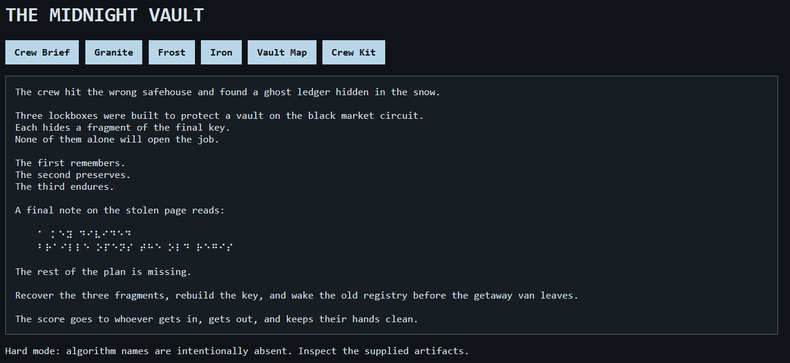
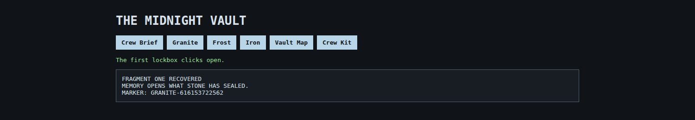
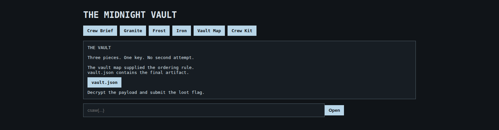

+++
date = '2026-09-20'
draft = false
title = 'Taking on the Temple'
description = 'A CSAW crypto/web writeup: cracking three chained ciphers to open the Midnight Vault.'
tags = ['Crypto', 'Web', 'CTF', 'CSAW']
+++

**CSAW CTF · Crypto / Web**

Three lockboxes, three ciphers, one AES-GCM vault: a heist-themed challenge that hides its algorithm names and dares you to read the artifacts instead.

`Crypto` · `Web / Flask` · `Vigenère Autokey` · `SHA-256 Keystream` · `AES-256-GCM`

---

## Recon

The challenge ships as a full source release: a small Flask app called **"The Midnight Vault,"** a `docker-compose.yml`, and a `data/` folder of puzzle artifacts. 

The whole game is narrated as a heist. A crew found "a ghost ledger hidden in the snow" guarding three lockboxes (**Stone**, **Frost**, and **Iron**), each hiding a fragment of a final key. None of them alone opens the job.



The page ends on a two-line braille clue. Grade-1 braille is a fixed, public alphabet, so it decodes cleanly by hand:

```
⠁ ⠅⠑⠽ ⠙⠊⠧⠊⠙⠑⠙                        →  A KEY DIVIDED
⠃⠗⠁⠊⠇⠇⠑ ⠕⠏⠑⠝⠎ ⠞⠓⠑ ⠕⠇⠙ ⠗⠑⠛⠊⠎         →  BRAILLE OPENS THE OLD REGIS…
```

(truncated; "wake the old registry" is the app's running refrain.)

It's flavor, not a required step. Every safe re-uses the same trick: each JSON artifact's `"braille"` field is just a grade-1 spelling of that safe's name (`STONE`, `IRON`, `VAULT`…), and it only confirms which lockbox you're looking at, nothing more.

Reading `app.py` and `artifacts.py` end to end removes all the guesswork the web UI tries to preserve: every algorithm, key derivation, and marker format is right there in the Python. The site's own hint admits as much:

> Hard mode: algorithm names are intentionally absent. Inspect the supplied artifacts.

So the job isn't cryptanalysis against an unknown cipher. It's implementing the exact inverse of three functions in `artifacts.py`, in the right order, using the previous stage's output as the next stage's key.

---

## Stage 1: Stone, the fragment that remembers

The Granite safe holds a block of ciphertext with no algorithm name attached: just an inscription ("What is remembered is never written only once") and three decoy markings designed to waste a solver's time.

.")

`artifacts.py` shows exactly how it was built: `autokey_encrypt(text, "STONE")`, a classic **Vigenère autokey** cipher. It strips everything but letters, uppercases, and encrypts using the primer `"STONE"` followed by the plaintext itself as the ongoing key stream. Knowing the primer, decryption isn't a crack at all. It's a direct, sequential inversion:

```python
def autokey_decrypt(ciphertext, primer):
    cipher = "".join(c for c in ciphertext.upper() if c.isalpha())
    key = "".join(c for c in primer.upper() if c.isalpha())
    out = []
    for i, ch in enumerate(cipher):
        k = ord(key[i]) - 65 if i < len(key) else ord(out[i - len(key)]) - 65
        out.append(chr((ord(ch) - 65 - k) % 26 + 65))
    return "".join(out)
```

Run against the safe's ciphertext, it unspools a full sentence: *"THE FIRST FRAGMENT IS NOT THE KEY ITSELF… MARKER: GRANITE. SUFFIX: \<twelve digits spelled out as words\>."* Stitching `GRANITE-` onto those twelve digits gives the fragment:

**K1 = `GRANITE-616153722562`**

The web app's answer box only checks that the marker string appears somewhere in the submitted text (a deliberately generous `verify()`), but that's not a shortcut, since the marker itself is a 12-digit number drawn from a 900-billion-value range. There's nothing to brute-force here; the plaintext has to be actually recovered.



---

## Stage 2: Frost, preservation is a trace of origin

Unlocking Frost hands over two files: a text plate and a raw 197-byte binary blob with no magic header. The text plate is where the "hard mode" hint pays off: it stamps the algorithm's shape without naming it:

```
BRAILLE: ICE
INSCRIPTION: WHAT IS PRESERVED REMEMBERS WHERE IT CAME FROM.
PAYLOAD: frost.bin
The copper plate has no algorithm name. Its edges are stamped with:
  SHA / 256 / 00
A maintenance mark reads: ORIGIN > SHAPE > LABEL
```


`SHA / 256 / 00` is describing `stream_xor()` almost literally: a counter-mode keystream where block `n` is `SHA-256(material || counter_be64)`, XORed against 32 bytes of data, counter starting at zero. The "origin" is the key material, `sha256(K1)`, i.e. the previous stage's marker:

```python
def stream_xor(data, material):
    out = bytearray()
    pos = counter = 0
    while pos < len(data):
        block = sha256(material + counter.to_bytes(8, "big")).digest()
        chunk = data[pos:pos + 32]
        out.extend(x ^ y for x, y in zip(chunk, block))
        pos += len(chunk); counter += 1
    return bytes(out)
```

The function is its own inverse (XOR is symmetric), so decrypting `frost.bin` with `material = sha256(K1.encode())` unwraps straight to plaintext: *"FROST RECORD… MARKER: CRYO-\<12 digits\>."*

**K2 = `CRYO-589377345945`**


---

## Stage 3: Iron, the shape of the answer is not the answer

The steel tablet reuses the same `stream_xor` cipher, but the key material this time is a small hash chain rather than a single digest. Rather than name it, the plate spells out the recipe as an instruction:

> Begin with marker two. Join that digest to marker one. Reverse that result before the final join to marker two.


Read literally, that's `reverse(sha256(sha256(K2) + K1)) + K2`, hashed once more:

```python
h0 = sha256(K2.encode()).digest()
h1 = sha256(h0 + K1.encode()).digest()
h2 = sha256(h1[::-1] + K2.encode()).digest()   # <- reversed, per the plate note
plaintext = stream_xor(iron_payload, h2)
```

Decrypting the payload with `h2` yields *"IRON RECORD… MARKER: FERRUM-\<12 digits\>."* The artifact also publishes plain `sha256(K1)`, `sha256(K2)`, and `sha256(K3)` as "columns": a built-in self-check that confirms all three fragments are correct before you move on, so there's no separate submission round-trip.

**K3 = `FERRUM-887740911828`**


---

## Stage 4: Vault, set all three where old locks meet

With all three fragments recovered, the `/altar` route unlocks a short poem that confirms the join order: the same order the three sections are named in, K1 · K2 · K3.




`vault.json` even hands over the KDF in plain English:

> Join the three complete markers in map order with \|, then SHA-256 the result for the AES-GCM key.

```python
key   = sha256(f"{K1}|{K2}|{K3}".encode()).digest()
nonce = base64.b64decode(vault["nonce_b64"])
aad   = vault["aad"].encode()
ct    = base64.b64decode(vault["ciphertext_b64"])
flag  = AESGCM(key).decrypt(nonce, ct, aad)
```

Against the local (fake-flag) instance, that unwraps cleanly:

```
csaw{fake_local_flag}
```


---

## The full solver

Claude made this nice one script that drives the whole chain end to end: fetch an artifact, decrypt it locally, POST the recovered plaintext to unlock the next stage's session flag, repeat. It takes an optional base URL, so the only thing that changes between the local Docker instance and the live CSAW target is one argument.

```
python3 solve.py [BASE_URL]     # defaults to http://localhost:5000
```

<details>
<summary><code>solve.py</code>: full source</summary>

```python
#!/usr/bin/env python3
"""Solver for the "Midnight Vault" (Taking on the Temple) CSAW challenge.

Usage:
    python3 solve.py [BASE_URL]

BASE_URL defaults to http://localhost:5000 (the local docker-compose instance).
Point it at the hosted competition instance later by passing its URL.
"""
import base64
import hashlib
import re
import sys

import requests
from cryptography.hazmat.primitives.ciphers.aead import AESGCM

DIGIT_WORDS = ("ZERO", "ONE", "TWO", "THREE", "FOUR", "FIVE", "SIX", "SEVEN", "EIGHT", "NINE")


def autokey_decrypt(ciphertext: str, primer: str) -> str:
    cipher = "".join(c for c in ciphertext.upper() if c.isalpha())
    key = "".join(c for c in primer.upper() if c.isalpha())
    out = []
    for i, ch in enumerate(cipher):
        k = ord(key[i]) - 65 if i < len(key) else ord(out[i - len(key)]) - 65
        out.append(chr((ord(ch) - 65 - k) % 26 + 65))
    return "".join(out)


def stream_xor(data: bytes, material: bytes) -> bytes:
    out = bytearray()
    pos = counter = 0
    while pos < len(data):
        block = hashlib.sha256(material + counter.to_bytes(8, "big")).digest()
        chunk = data[pos:pos + 32]
        out.extend(x ^ y for x, y in zip(chunk, block))
        pos += len(chunk)
        counter += 1
    return bytes(out)


def parse_digit_words(s: str, start: int, count: int) -> str:
    pos = start
    digits = []
    for _ in range(count):
        for d, w in enumerate(DIGIT_WORDS):
            if s.startswith(w, pos):
                digits.append(str(d))
                pos += len(w)
                break
        else:
            raise ValueError(f"could not parse digit word at pos {pos}: {s[pos:pos + 20]!r}")
    return "".join(digits)


def recover_k1(stone_ciphertext: str) -> str:
    plain = autokey_decrypt(stone_ciphertext, "STONE")
    idx = plain.index("SUFFIX")
    digits = parse_digit_words(plain, idx + len("SUFFIX"), 12)
    return f"GRANITE-{digits}"


def recover_k2(frost_bytes: bytes, k1: str) -> str:
    material = hashlib.sha256(k1.encode()).digest()
    plain = stream_xor(frost_bytes, material).decode()
    m = re.search(r"MARKER:\s*(CRYO-\d{12})", plain)
    if not m:
        raise ValueError(f"K2 marker not found in frost plaintext: {plain!r}")
    return m.group(1)


def derive_h2(k1: str, k2: str) -> bytes:
    h0 = hashlib.sha256(k2.encode()).digest()
    h1 = hashlib.sha256(h0 + k1.encode()).digest()
    h2 = hashlib.sha256(h1[::-1] + k2.encode()).digest()
    return h2


def recover_k3(iron_payload_b64: str, k1: str, k2: str) -> str:
    h2 = derive_h2(k1, k2)
    payload = base64.b64decode(iron_payload_b64)
    plain = stream_xor(payload, h2).decode()
    m = re.search(r"MARKER:\s*(FERRUM-\d{12})", plain)
    if not m:
        raise ValueError(f"K3 marker not found in iron plaintext: {plain!r}")
    return m.group(1)


def recover_flag(vault_json: dict, k1: str, k2: str, k3: str) -> str:
    key = hashlib.sha256(f"{k1}|{k2}|{k3}".encode()).digest()
    nonce = base64.b64decode(vault_json["nonce_b64"])
    aad = vault_json["aad"].encode()
    ciphertext = base64.b64decode(vault_json["ciphertext_b64"])
    return AESGCM(key).decrypt(nonce, ciphertext, aad).decode()


def main():
    base = sys.argv[1] if len(sys.argv) > 1 else "http://localhost:5000"
    base = base.rstrip("/")
    s = requests.Session()

    stone = s.get(f"{base}/artifact/stone.json").json()
    k1 = recover_k1(stone["ciphertext"])
    print(f"K1 = {k1}")
    r = s.post(f"{base}/stone", data={"answer": k1})
    assert "FRAGMENT ONE RECOVERED" in r.text, r.text

    frost_bytes = s.get(f"{base}/artifact/frost.bin").content
    k2 = recover_k2(frost_bytes, k1)
    print(f"K2 = {k2}")
    r = s.post(f"{base}/frost", data={"answer": k2})
    assert "FRAGMENT TWO RECOVERED" in r.text, r.text

    iron = s.get(f"{base}/artifact/iron.json").json()
    k3 = recover_k3(iron["payload_b64"], k1, k2)
    expected_cols = [hashlib.sha256(k.encode()).hexdigest() for k in (k1, k2, k3)]
    assert iron["columns"] == expected_cols, (iron["columns"], expected_cols)
    print(f"K3 = {k3}")
    r = s.post(f"{base}/iron", data={"answer": k3})
    assert "FRAGMENT THREE RECOVERED" in r.text, r.text

    vault = s.get(f"{base}/artifact/vault.json").json()
    flag = recover_flag(vault, k1, k2, k3)
    print(f"FLAG = {flag}")

    r = s.post(f"{base}/vault", data={"flag": flag})
    assert "THE VAULT IS OPEN" in r.text, r.text
    print("Vault confirmed open on the server.")


if __name__ == "__main__":
    main()
```

</details>

